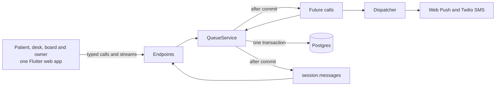

# Docket

Docket. Wait anywhere.

Docket lets walk-in patients wait anywhere. The clinic taps one button, every phone in line moves at once, and missed calls re-slot on timers that survive a server restart.

A screenshot of the line is wrong the moment the doctor calls the next patient.

Watch the 1:43 demo: <https://youtu.be/MdIzNYwsgAQ>. Try it live: <https://docket.serverpod.space/try>.


A desk tap moves the patient's phone. Recorded with Playwright on the live app at docket.serverpod.space, desk and phone side by side, sped up as shown.


The desk loses its connection, keeps calling, and syncs when it's back. The phone catches up. Same recording setup.

A re-slot landing after a server restart isn't recorded as a GIF. It's measured instead, see below.

## Try it

1. Open <https://docket.serverpod.space/try> and tap Open my sandbox desk. Target: about 5 s.
2. Scan the join QR beside the desk with your phone and join the line. Target: about 10 s.
3. Tap Call next on the desk. The phone changes. Measured from Lagos against Serverpod Cloud's small compute: 2.7, 3.4 and 4.7 s from the click to the phone's text in three Playwright runs. The same path takes 1.09 s against a local server in one run. Why, and what fixes it: [SPONSOR_FINDINGS F7](docs/SPONSOR_FINDINGS.md).

- Live app: <https://docket.serverpod.space/try>
- Site: <https://docket.serverpod.space/>
- Demo video: <https://youtu.be/MdIzNYwsgAQ>
- Launch post on X: <https://x.com/winsznx/status/2110485484325531676>

The sandbox is a throwaway clinic with its own desk, board and join link. It needs no account, never sends SMS, holds at most 200 tickets and expires after 24 hours. The next nightly job deletes it. Add 5 demo walk-ins fills the line with tickets labelled DEMO, created through the same join path a patient uses.

## Built on Serverpod 4

| Concern | Serverpod feature | Where Docket uses it |
| --- | --- | --- |
| API | Typed endpoints and the generated client | [`docket_server/lib/src/endpoints/`](docket_server/lib/src/endpoints/), client in [`docket_client/`](docket_client/) |
| Real time | Streaming methods fed by `session.messages` channels | `watch` in [`ticket_endpoint.dart`](docket_server/lib/src/endpoints/ticket_endpoint.dart), [`desk_endpoint.dart`](docket_server/lib/src/endpoints/desk_endpoint.dart) and [`board_endpoint.dart`](docket_server/lib/src/endpoints/board_endpoint.dart), posts from [`queue_service.dart`](docket_server/lib/src/domain/queue_service.dart) |
| Timers | Future calls, one-off and recurring | [`ticket_timers_future_call.dart`](docket_server/lib/src/future_calls/ticket_timers_future_call.dart), [`dispatch_future_call.dart`](docket_server/lib/src/future_calls/dispatch_future_call.dart), [`clinic_jobs_future_call.dart`](docket_server/lib/src/future_calls/clinic_jobs_future_call.dart), recurring calls in [`server.dart`](docket_server/lib/server.dart) |
| Data | ORM, transactions, `LockMode.forUpdate` | `_lockLines` and every command in [`queue_service.dart`](docket_server/lib/src/domain/queue_service.dart) |
| Offline desk | Client-side database with `database: client` | [`docket_server/lib/src/models/client/`](docket_server/lib/src/models/client/), [`desk_store.dart`](docket_flutter/lib/surfaces/desk/offline/desk_store.dart) |
| Auth | Email sign-in and JWT from `serverpod_auth_idp` | [`server.dart`](docket_server/lib/server.dart), [`docket_server/lib/src/auth/`](docket_server/lib/src/auth/), clinic roles in [`clinic_auth.dart`](docket_server/lib/src/security/clinic_auth.dart) |
| Web | Relic routes, `FlutterRoute`, `WidgetRoute` site pages, JSON first paint, PDF posters | [`server.dart`](docket_server/lib/server.dart), [`docket_server/lib/src/web/routes/`](docket_server/lib/src/web/routes/), [`site.dart`](docket_server/lib/src/web/site/site.dart) |
| Hosting | Serverpod Cloud | [`docket_server/scloud.yaml`](docket_server/scloud.yaml) |
| Observability | Insights, `/livez`, `/readyz`, `/startupz`, custom health indicators | [`health.dart`](docket_server/lib/src/web/health.dart) |
| Dev loop | `serverpod start` with embedded Postgres and hot reload | [`docket_server/pubspec.yaml`](docket_server/pubspec.yaml), [`config/development.yaml`](docket_server/config/development.yaml) |

## How it works

One Flutter web app serves the patient, desk, board and owner surfaces by route. Every surface talks to the server through the generated client, with typed calls over HTTP and streaming methods over a WebSocket. Every ticket change goes through `QueueService`, which locks the line row, writes the ticket, a `TicketEvent`, the bumped line version and any notifications in one Postgres transaction. After commit it schedules future calls and posts `LineChanged`, and every open stream on that line rebuilds its view.



[docs/ARCHITECTURE.md](docs/ARCHITECTURE.md) has the full diagrams: the Call next sequence, the ticket state machine, timers, the notification pipeline, the offline desk and the view cache. [docs/SECURITY.md](docs/SECURITY.md) covers trust boundaries and how contact data is sealed.

## Run it locally

[docs/SETUP.md](docs/SETUP.md) walks through a fresh clone step by step. In short, with Flutter 3.44.4 or later and the Serverpod CLI installed:

```bash
flutter pub get                       # at the repo root, it's a pub workspace
cd docket_server
# create config/passwords.yaml first, docs/SETUP.md shows the keys
dart run tool/secrets.dart generate   # Web Push keys and the phone encryption key
serverpod run flutter_build           # builds the web app into web/app
serverpod start                       # embedded Postgres, server, hot reload
```

The API listens on port 8080, Insights on 8081 and the web server on 8082. Postgres runs embedded, so there's no Docker. In development, sign-in verification codes print to the server log.

## Run the tests

From the repo root:

```bash
(cd docket_server && dart test)        # unit and integration tests
(cd docket_flutter && flutter test)    # widget and theme tests
(cd e2e && npm ci && npx playwright install chromium webkit && npm test)
```

`dart test` starts its own embedded test database, so nothing needs to run first. `dart test -x integration` runs only the unit tests. The Playwright suite runs in Chromium and WebKit against `BASE_URL`, so point it at the server you want to check, such as `BASE_URL=http://localhost:8082 npm test`. The load and restart scripts live in [`loadtest/bin/`](loadtest/bin/).

## Measured numbers

Every number Docket publishes comes from a recorded run with its run count. The full table and the raw readings are in [docs/SPONSOR_BEHAVIOUR.md](docs/SPONSOR_BEHAVIOUR.md).

- A server restart inside a 60-second grace window: the missed call still went back in line 401, 773 and 784 ms after the window closed (3 runs, local). On Serverpod Cloud, with a redeploy inside a 180-second window: 1148 ms (1 run).
- 300 patient streams on one line with a call every 2 seconds: p50 180 ms, p95 196 ms, max 209 ms from the desk's action to each phone (4,500 samples, local, server and clients on one M1 Pro).
- Fifty pairs of Call next fired together from two desks: 40 distinct tickets called, 60 "No one is waiting", zero duplicates (integration test).
- Idle streams on Serverpod Cloud with the default 30-second ping: 2 of 3 lived a full 600 s, 1 closed at 562 s and reconnects on its own.
- On Serverpod Cloud's small compute, a fixed CPU loop runs about 21 times slower (805 ms against 38 ms) than on the M1 Pro, so tap to phone there took 2.7 s against 1.09 s locally, one run each. See [SPONSOR_FINDINGS F7](docs/SPONSOR_FINDINGS.md).

## Limits

- The live app has no Twilio credentials yet, so it sends no texts. The dispatcher records each one as skipped with "SMS isn't configured on this server." and Web Push still works. Once Twilio is set up, a trial account delivers only to verified numbers.
- In Nigeria, MTN, Airtel and 9mobile block numeric international senders. An alphanumeric sender ID needs registration through Twilio, which takes two to three weeks. Until one is registered, texts from an international number won't reach those networks.
- iOS delivers Web Push only to web apps added to the Home Screen, on iOS 16.4 and later. On an iPhone outside the Home Screen, the patient page shows the steps to add Docket and offers SMS beside them when the clinic has it.
- Serverpod Cloud's Starter plan has future calls off. Docket is built for the Growth plan, where they're on. On a server without future calls, `LocalScheduler` applies the same timer rules from Postgres once a second, and `/readyz` reports which mode is running under `docket:timer-mode`.

## AI disclosure

Built by Popoola Timothy with Claude Code as the coding agent under his direction, using the Serverpod agent skills and MCP server from `serverpod start`. Docket runs live on Serverpod Cloud.

## License

MIT, copyright 2026 Popoola Timothy. See [LICENSE](LICENSE).
