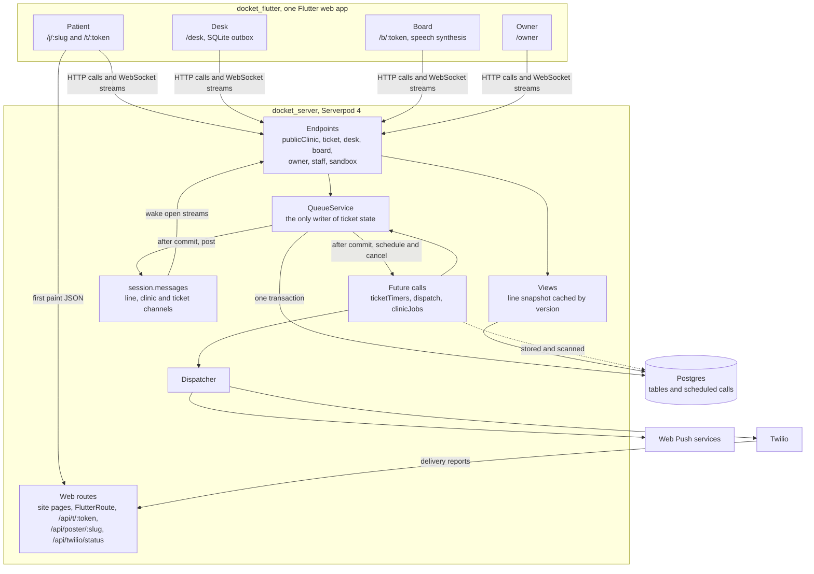
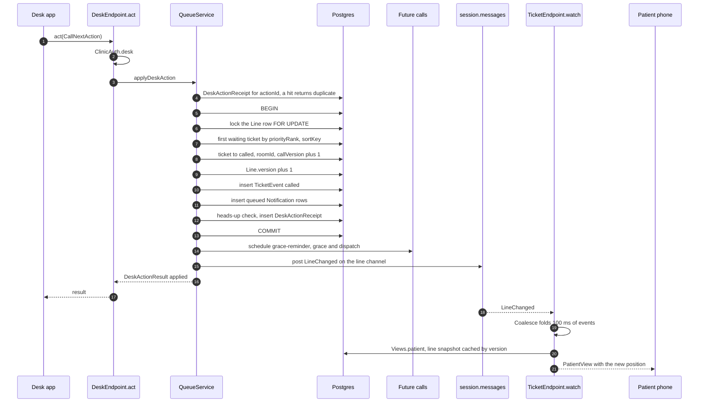
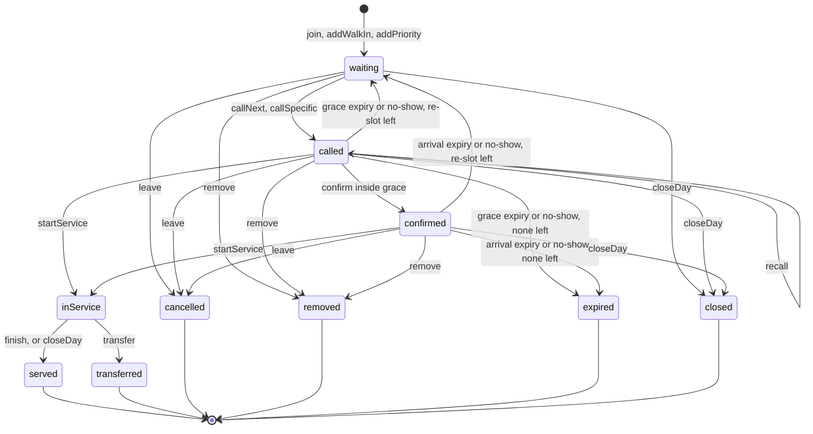
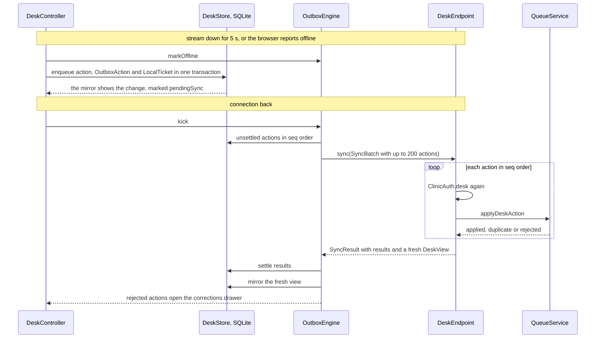

# Architecture

Docket is one Serverpod 4 server, `docket_server`, and one Flutter web app, `docket_flutter`, that serves every surface by route. The generated client in `docket_client` connects them. Postgres holds all state, including the timers, which are Serverpod future calls stored as rows. This page follows a desk tap from the button to the patient's phone, then covers the ticket states, the channels, timers, notifications, the offline desk and the view cache.

## The pieces



Endpoints validate input, authorize and return views. They never change ticket state themselves. Every change goes through a static method on `QueueService` in [`domain/queue_service.dart`](../docket_server/lib/src/domain/queue_service.dart): `join`, `confirm` and `leave` for patients, `applyDeskAction` for every desk action, `linkPhone`, `openDay` and `closeDay`, and `graceReminder` and `windowExpired` for the timers. Future calls reach the same methods, so a timer and a person follow the same rules.

## Call next, from tap to phone



The line lock is what makes two desks safe. Two Call next taps on the same line serialize on `Line.db.findById(session, id, lockMode: LockMode.forUpdate, transaction: t)` in `_lockLines`, so one desk gets the first eligible ticket and the other gets the next one or "No one is waiting". `_lockLines` sorts ids before locking, so a transfer that locks two lines can't deadlock with another transfer going the other way.

A replayed action that races its original hits the unique index on `DeskActionReceipt.actionId`. The loser catches `DatabaseUniqueViolationException`, reads the stored receipt and returns `duplicate`.

Future-call scheduling and channel posts take no transaction, so they run after commit in `_afterCommit`. If the process dies in that gap, the 30-second `timerSweep` applies any overdue window and re-enqueues any notification that never got a dispatch call. If a post is lost, every stream rebuilds on its 20-second heartbeat anyway.

## Ticket states



The table lives as data in `Transitions.table` in [`domain/transitions.dart`](../docket_server/lib/src/domain/transitions.dart). A missing entry is a refused transition, and `QueueService._guard` throws `invalidTransition` for it. A miss goes through `MissRule.decide`: while `reslotCount < maxReslots` the ticket goes back to `waiting` at position `reslotOffset` among normal-priority tickets, or last when fewer wait, with its heads-up reset. Otherwise it expires. A transfer finishes the ticket in one line and opens a linked `waiting` ticket in the other, and the old ticket's view carries the new token so the patient page follows it.

Every transition writes one `TicketEvent` and bumps `Line.version` in the same transaction. `LineChanged` goes out after commit.

## Channels

Streams wake on Serverpod server events. Every post uses the default `MessageScope.auto`, which goes cluster-wide when Redis is enabled and stays inside the podlet otherwise.

| Channel | Payload | Posted when | Who listens |
| --- | --- | --- | --- |
| `line.<lineId>` | `LineChanged(lineId, version, reason)` | Any change that bumps the line version, which is every ticket transition, a room state change, a relink and a change to a ticket's alerts. Also a desk heartbeat that flips presence, `presenceSweep` when presence lapses, and `Dispatcher` after it records a delivery status, so the desk's delivery chips update | `TicketEndpoint.watch` for the patient's line, `DeskEndpoint.watch` and `BoardEndpoint.watch` for every line of the clinic |
| `clinic.<clinicId>` | `ClinicChanged(clinicId)` | A service day opens or closes, a room changes state, or the owner changes settings, lines, rooms or the board token | `DeskEndpoint.watch`, `BoardEndpoint.watch` |
| `ticket.<ticketId>` | `TicketChanged(ticketId, version)` | A recall, and the old ticket of a transfer | `TicketEndpoint.watch` |

`BoardEndpoint.watch` re-reads the clinic on every event and ends the stream when the board token was rotated, so an old board link stops working at once.

## Timers

All timers are Serverpod future calls, declared in [`future_calls/`](../docket_server/lib/src/future_calls/) and run through the generated accessors `ticketTimers`, `dispatch` and `clinicJobs`.

| Call | Scheduled by | Runs at | Identifier | Does |
| --- | --- | --- | --- | --- |
| `ticketTimers.graceReminder` | `QueueService._call` | Grace end minus `graceReminderSeconds`, only when that's shorter than grace | `grace-reminder:<ticketId>:<callVersion>` | `QueueService.graceReminder` writes one `graceReminderSent` event and queues the reminder push, if the ticket is still `called` with that `callVersion` |
| `ticketTimers.graceExpired` | `QueueService._call` | `calledAt + graceSeconds` | `grace:<ticketId>:<callVersion>` | `QueueService.windowExpired` applies the miss rule if the ticket is still `called` with that `callVersion` |
| `ticketTimers.arrivalExpired` | `QueueService.confirm` | `confirmedAt + arrivalSeconds` | `arrival:<ticketId>:<callVersion>` | The same check for `confirmed` |
| `dispatch.send` | `_afterCommit`, then `Dispatcher` for retries | At once, then 30 s and 120 s later | `dispatch:<notificationId>:<attempt>` | `Dispatcher.send` delivers one notification |
| `clinicJobs.autoCloseDay` | `QueueService._ensureDay` when a service day first opens | `closeTime + autoCloseAfterMinutes` in the clinic's timezone | `autoclose:<clinicId>:<serviceDate>` | Closes the day if it's still open |
| `clinicJobs.timerSweep` | `lib/server.dart` after `pod.start()` | Every 30 s | `timer-sweep` | Applies any grace or arrival window more than 2 s overdue, and re-enqueues notifications still queued with no attempt after 45 s as `dispatch:<notificationId>:sweep` |
| `clinicJobs.presenceSweep` | `lib/server.dart` | Every 15 s | `presence-sweep` | Posts `LineChanged` for clinics whose desk heartbeat just lapsed, so patients see the desk-offline banner |
| `clinicJobs.nightly` | `lib/server.dart` | Cron `0 1 * * *`, 01:00 UTC | `nightly` | Day reports, contact purge, sandbox cleanup |

Scheduling looks like this, from `QueueService._call`:

```dart
fx.after.add(
  (s) => s.serverpod.futureCalls
      .callAtTime(graceEnd, identifier: 'grace:$id:$version')
      .ticketTimers
      .graceExpired(id, version),
);
```

Confirm, start service, a miss, leave, remove and close day cancel the open windows by identifier through `_cancelGrace` and `_cancelArrival`. Cancelling is a courtesy. Future calls run at least once and may run twice, so correctness comes from every handler re-checking state and `callVersion` inside its own transaction. A late or duplicate run changes nothing. `graceReminder` also checks for an existing `graceReminderSent` event since the call, so it sends once.

The recurring calls register after `pod.start()`, since scheduling before start throws, and each is cancelled by identifier first so a restart never stacks duplicates. The config for every run mode sets `futureCallExecutionEnabled: true` with `scanInterval: 1000`, `concurrencyLimit: 8`, `checkBrokenCalls: true` and `deleteBrokenCalls: true`. Deleting broken calls is safe because `timerSweep` covers any window whose call was dropped.

The nightly job in `ClinicJobs.nightly` stores a `DayReport` for each closed day that lacks one. It deletes `SmsTarget` and `PushTarget` rows and renames tickets to "Patient" for service days that closed more than 24 hours ago. It deletes expired sandbox clinics with everything they own. It deletes `RateBucket` rows older than two days, and it clears `reason` and `actorRef` on events older than 30 days.

### Servers without future calls

Serverpod Cloud's Starter plan turns future calls off, and then the generated `futureCalls` throws on every use. `Timers.scheduling` and `Timers.executing` in [`domain/timers.dart`](../docket_server/lib/src/domain/timers.dart) read the server's config. When this server can't run future calls, `lib/server.dart` starts `LocalScheduler` from [`domain/local_scheduler.dart`](../docket_server/lib/src/domain/local_scheduler.dart) instead of registering the recurring calls, and `_afterCommit` skips scheduling. Once a second, `LocalScheduler` runs `timerSweep` with no age or slack, `dueReminders`, `dispatchQueued` and `autoCloseDue`, plus `nightly` once in the 01:00 UTC hour. `presenceSweep` runs every 15 seconds. These are the same idempotent rules over the same Postgres rows, so a restart still can't lose a place. `/readyz` reports the mode under `docket:timer-mode`.

## Notification pipeline

1. Inside the state-change transaction, `QueueService._notify` asks `NotificationPolicy.channels` in [`domain/notification_policy.dart`](../docket_server/lib/src/domain/notification_policy.dart) which channels a kind goes out on. Push needs an active `PushTarget`. SMS needs an active `SmsTarget` on a clinic with SMS on that isn't a sandbox, and most kinds only text when push isn't active. One `Notification` row per channel is inserted as `queued` with a unique `dedupeKey` of `<ticketId>:<kind>:<channel>:<callVersion>:<reslotCount>`. The insert ignores conflicts, so a duplicate timer run can't queue a second message. A recall adds `recall-<eventId>` to the key so the repeat call goes out.
2. After commit, `_afterCommit` schedules `dispatch.send(notificationId)` with no delay.
3. `Dispatcher.send` in [`notify/dispatcher.dart`](../docket_server/lib/src/notify/dispatcher.dart) loads the row and returns unless it's still `queued`, counts the attempt, and sends through `WebPushSender` or `TwilioSmsSender`. Success records `sent` with a provider reference, which is the push service's status code or the Twilio message SID. It then posts `LineChanged` with reason `delivery`, so the desk's "Push sent" and "SMS sent" chips update.
4. A transient failure reschedules at 30 seconds, then 120 seconds. After the third attempt the row is `failed`. For SMS, transient means a timeout, a network error, a 429 or a 5xx from Twilio.
5. A push endpoint that answers 404 or 410 is gone. The dispatcher deactivates the `PushTarget`, marks the row `failed`, and `_smsFallback` queues an SMS row when the policy allows a text with push off.
6. Every Twilio send passes `StatusCallback` set to `PUBLIC_BASE_URL/api/twilio/status`. `TwilioStatusRoute` checks the `X-Twilio-Signature` header against the auth token, then moves the row to `delivered`, `undelivered` or `failed`. The owner's notification log shows what reached a phone, not only what Twilio accepted.

Web Push is built in Dart on `pointycastle` in [`notify/web_push.dart`](../docket_server/lib/src/notify/web_push.dart). VAPID is an ES256 JWT that lasts 11 hours 55 minutes. The payload is one `aes128gcm` record per RFC 8291, capped at 3993 bytes of plaintext. A `called` push carries `Urgency: high` and a `TTL` equal to the grace seconds left, at least 30. A grace reminder is also `high`. Other kinds use `normal` and a one-hour TTL. The `Topic` header is the kind plus the ticket id, so a newer message of the same kind replaces an older one. A unit test in `test/unit/notify/web_push_test.dart` reproduces the RFC 8291 Appendix A example.

## Offline desk

The desk keeps calling through an internet outage. The code is in [`docket_flutter/lib/surfaces/desk/offline/`](../docket_flutter/lib/surfaces/desk/offline/), on three `database: client` tables from [`docket_server/lib/src/models/client/`](../docket_server/lib/src/models/client/): `LocalTicket`, `OutboxAction` and `DeskMeta`. `LocalDb` opens `docket_desk.db` through the generated client. On the web it runs in `db_worker.js` over `sqlite3.wasm`, which lets a board tab in the same browser profile share it.



- One path for every action. `DeskStore.enqueue` writes the action to `OutboxAction` and applies it to `LocalTicket` in one client-database transaction, with `seq` taken from `DeskMeta.nextSeq`, which only grows. Online, `OutboxEngine` sends each action through `desk.act` the moment it's written. Offline, it waits. The code path is the same.
- Local rules. `LocalRules.apply` in `local_rules.dart` mirrors `QueueService` for each action using local data only. Call next takes the first eligible `LocalTicket` of the room's line. A walk-in gets a UUID v7 minted on the device and a label such as "C-?" until the server numbers it, and the server accepts the same id on replay. While a call is pending, the patient isn't notified yet. The server starts the grace window when it receives the call.
- Mirror. On every `DeskView`, `DeskStore.mirror` upserts every ticket of the clinic's lines and deletes rows the server no longer lists, keeping rows still `pendingSync` while their actions are in flight. `DeskMeta.lastViewJson` keeps the last view, so a reload while offline still draws the desk.
- Going offline. `DeskController` marks the desk offline when its stream stays down for `offlineAfter`, which is 5 seconds, or when `BrowserNetwork` sees `navigator.onLine` go false.
- Sync. `desk.sync` applies each action under the normal rules, checks authorization again for each, rejects actions whose `deviceId` doesn't match the batch, and returns per-action results with a fresh view. The server always wins. Rejected actions never retry on their own. They land in the corrections drawer with the server's message. Duplicates settle quietly.
- Local board mode. `DeskDatabaseBoardSource` in `docket_flutter/lib/surfaces/board/local_board_source.dart` builds a board from the desk's tables when the board's own stream is down, so a board tab beside the desk keeps announcing calls made at that desk.
- App shell. `registerAppShellWorker` in `app_shell_worker.dart` registers `/push-sw.js` at scope `/`, the worker that handles Web Push and caches the app shell for a reload during an outage.

## Views and the line cache

Every client view is built in [`domain/views.dart`](../docket_server/lib/src/domain/views.dart). The expensive part of a patient or board view is the ordered list of a line's active tickets with their alert flags. `Views.lineSnapshot` builds that once and stores it in `session.caches.local` under `line:<lineId>:<version>` for 10 seconds. Every change bumps the version in the database, and every view reads the current `Line` row first, so a change always lands on a fresh key and a stale snapshot is never served. A hundred phones on one line share one build per version on each podlet. `PublicClinicEndpoint.getClinic` and the dispatcher's heads-up copy read the same snapshot. The desk view builds its lines directly, since it also carries per-call delivery status.

`TicketEndpoint.watch` shows the pattern every stream follows:

```dart
yield await Views.patient(session, ticket.id!);
final events = StreamGroup.merge<Object?>([
  session.messages.createStream<LineChanged>('line.${ticket.lineId}'),
  session.messages.createStream<TicketChanged>('ticket.${ticket.id}'),
  Stream<Object?>.periodic(heartbeat),
]);
await for (final _ in events.transform(
  const Coalesce<Object?>(Duration(milliseconds: 100)),
)) {
  yield await Views.patient(session, ticket.id!);
}
```

`Coalesce` in [`util/coalesce.dart`](../docket_server/lib/src/util/coalesce.dart) folds a burst of events inside 100 ms into one rebuild. The 20-second heartbeat rebuilds from the database even if a message was lost.

On the client, `LiveStream` in `docket_flutter/lib/shared/live_stream.dart` marks itself stale on a stream error, retries after 1, 2, 4 and 8 seconds and then every 15, takes a snapshot on reconnect and reopens the stream. Every view carries `serverTime`, and `ServerClock` keeps the offset from it, so countdowns run on server time and a phone with a wrong clock still shows the right seconds.

Desk presence feeds both the ETA and the patient's desk-offline banner. The desk calls `desk.heartbeat` every 15 seconds. A room counts as active for the ETA when it's open and a desk for it has sent a heartbeat in the last 45 seconds. The ETA is `ceil(position / activeRooms) * medianService`, with the median of the line's last 10 service samples, or the line's `defaultServiceSeconds` until 3 samples exist.
